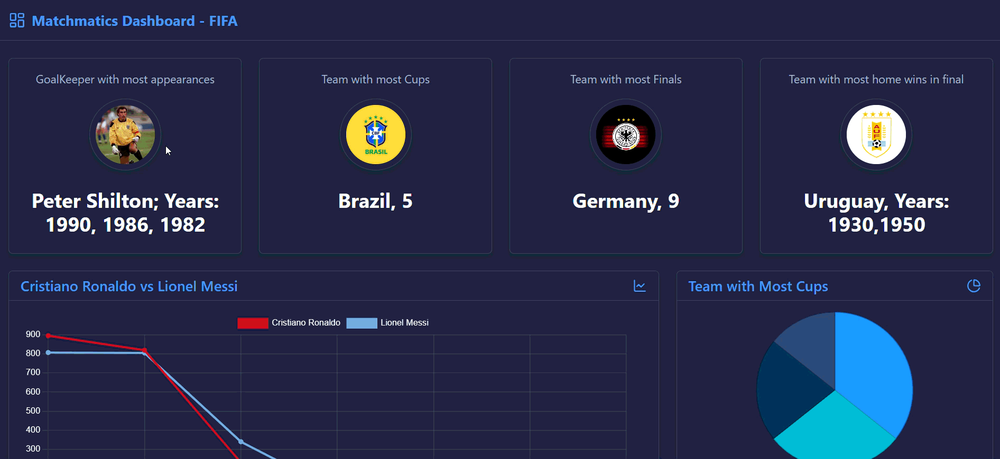

# Matchmatics: Fusion of Math and Statistics in Sports

A centralized sports database and analytics dashboard that brings **ODI cricket, FIFA football, and NBA basketball** data together in one PostgreSQL database (`sportsdb`), with a React web app on top for exploring it.

Built as a team project for a database course at the University at Buffalo, SUNY.

---

## 1. What is the project?

Sports generate huge amounts of data, but analysts, coaches, and fans often end up working with disconnected Excel sheets and one-off scripts, especially across multiple sports. Matchmatics solves this by putting three sports into a single, well-designed relational database and giving users an easy interface to explore it.

- **One database, three sports.** A central `Sports` table links the ODI cricket, FIFA, and NBA schemas, so records from every sport are tied to the right sport.
- **Query and update support.** The schema is in BCNF and supports joins, indexing, stored procedures, and transactional updates.
- **Dashboard instead of a news-page look.** Users pick a sport, land on a dashboard with visualizations of its statistics, and can run queries against that sport's tables to pull specific data.

**Example questions it can answer**

| Sport | Example query |
|---|---|
| Cricket | Top run scorers across all ODIs, partnerships of 200+ runs, bowlers with the best economy |
| FIFA | Players with the most World Cup tournaments, appearances by team and position, starters vs. substitutes |
| NBA | Head-to-head records between two teams, highest-scoring games, first pick of each draft round |

**Datasets**

- FIFA: [football.db / openfootball](https://openfootball.github.io/docs/json-api-intro.html) (`players`, `player_appearances`, `squads`)
- NBA: [Kaggle NBA Database](https://www.kaggle.com/datasets/wyattowalsh/basketball/data) (`player`, `draft_history`, `game`, `game_summary`, `other_stats`, `line_score`)
- ODI Cricket: [Kaggle ODI Matches Historical Data](https://www.kaggle.com/datasets/bhuvaneshprasad/odi-matches-historical-data-since-1971) (`matches`, `batting`, `bowling`, `partnerships`, `fall_of_wickets`, `cric_players`)

---

## 2. Tech stack

| Layer | Technology |
|---|---|
| Frontend | React, TypeScript, Bootstrap, Tailwind CSS |
| Backend | Node.js, Express, TypeScript, REST APIs |
| Database | PostgreSQL |
| Database design | ER modelling, relational schema, BCNF normalization |
| Performance | B-tree and composite indexes, `pg_trgm` + GIN indexes for text search, `EXPLAIN` analysis |
| Database logic | Stored procedures, transactions with rollback, trigger-based failure logging |

---

## Preview: FIFA dashboard

  

---

## 3. My contribution

Co-built a cross-sport analytics app over **5M+ cricket, football, and basketball records** with a 3-person team. I owned the FIFA data layer, the REST APIs and the frontend.

### Backend and APIs

- Wrote **TypeScript APIs in Node.js and Express on PostgreSQL**, reaching **10-second page loads** over the full dataset.
- Designed **REST API workflows for 10+ performance indicators**, with filtering and pagination.
- Sped up **multi-filter lookups by over 10%** by adding composite and range indexes in PostgreSQL, validated with `EXPLAIN` query plans.

### FIFA data and database design

- Handled all of the FIFA datasets end to end, including the `players`, `player_appearances`, and `squads` tables.
- Designed the FIFA relational schema (primary and foreign keys to the central `Sports` table, player positions, tournament history, starter/substitute flags) and verified it against BCNF.
- Wrote the FIFA SQL queries behind the dashboard: joins, `GROUP BY` aggregations, subqueries, and `ORDER BY` leaderboards such as most tournaments played.
- Optimized text and filter searches on player and position data with trigram (`pg_trgm`) GIN indexes and composite indexes.

### Frontend

- Built the entire React + TypeScript frontend and styled it with Bootstrap and Tailwind CSS.
- Designed the user flow: pick a sport (cricket, football, or basketball) and land on that sport's dashboard.
- Built the dashboard visualizations: stat cards plus line, pie, and bar charts that pull their data from the APIs.
- Built the query interface for fetching data from each sport's tables.

---

## Team

- Anchal Daga
- Shruti Kumari
- V L Sivasai Mani Harshith Bhattaram

*Course instructor: Prof. Shamshad Parvin. TA: Vamshi Krishna Kyatham.*
